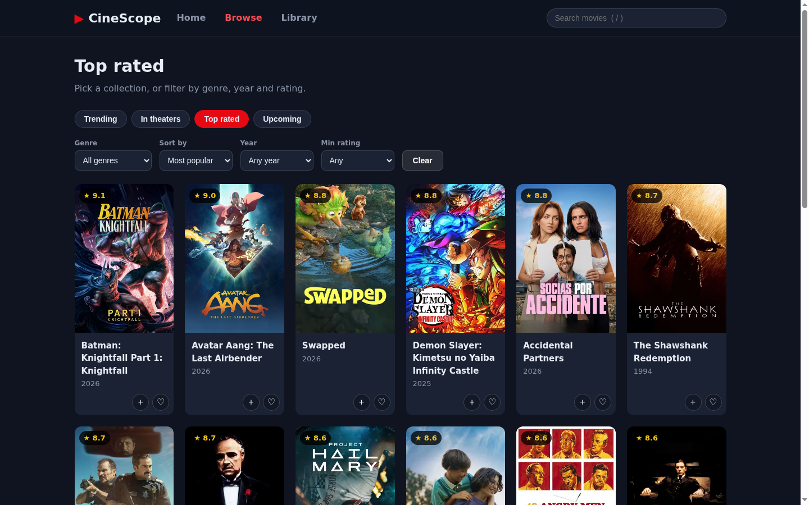

# CineScope - Movie Discovery App

A movie discovery app powered by the TMDB API. Browse what's trending this week,
search any title, open full details with the top cast, and keep a favorites list
that persists between visits.

**Live demo:** https://malakmo7amed309.github.io/movie-app/

## Screenshots

| Home | Browse |
| --- | --- |
|  |  |

| Movie details | Mobile |
| --- | --- |
|  |  |

## Features

- Home with a featured trending movie (trailer, details, watchlist) and four rows: trending, in theaters, top rated, upcoming
- Browse page: pick a collection, or filter by genre, year, minimum rating and sort order. Filters live in the URL and results load page by page
- Search with debounce, results in the URL, load more, and your recent searches. Press `/` on any page to jump to the search box
- Movie details: backdrop, rating, runtime, genres, overview, trailer in a modal, top cast and recommendations
- Library with three lists (favorites, watchlist, watched), sorting and clear with confirmation. Saved in localStorage. Old favorites are migrated
- Loading skeletons, error states with working retry, keyboard friendly, skip link, reduced-motion support
- Fully responsive, custom dark cinema theme (no UI framework)

## Tech stack

- React 19 + Vite
- React Router 7 (client-side routing with a 404 page)
- axios
- TMDB API
- Plain CSS (custom properties, grid, responsive breakpoints)

## Getting started

```bash
npm install
npm run dev
```

Then open http://localhost:5173

The TMDB key lives in `src/config.js`. Get a free key at
https://www.themoviedb.org/settings/api and replace the placeholder.

Production build:

```bash
npm run build
npm run preview
```

## How it works (plain language)

See [docs/how-it-works.md](docs/how-it-works.md) for a walkthrough of the code
and the concepts behind it.

## Author

Malak Mohamed - [GitHub](https://github.com/malakmo7amed309)

This product uses the TMDB API but is not endorsed or certified by TMDB.
